# PathSnap: Distributed Map-Matching and Route Reconstruction

**Technical report (DRAFT for team review, not final)**

Team: PES1UG24CS497, PES1UG24CS496, PES1UG24CS549, PES1UG24CS548
Repository: https://github.com/AaryaTedla/pes-ml-hackathon

> Items marked **[NEEDED: ...]** require evidence only the team can supply (screenshots from the demo laptops, AI-use statements).
> Every number comes from a committed result file; see `report/numbers_sheet.md`.

## 1. Problem and system overview

GPS positions are noisy, so a vehicle on one road can appear on a parallel street. Given a trip's GPS points and its own road network, PathSnap
decides which road segment (arc) the vehicle was on at each point and reconstructs a connected route. A classifier scores each candidate arc near a
GPS point using 18 features (distance, heading, speed, neighbouring points, road geometry). A Hidden Markov Model with Viterbi decoding then chooses
the best consistent sequence of arcs using the road graph. The final system is a FastAPI server (laptop 1) that runs the full pipeline and scores the
result against the reference route on the server only, plus a browser UI (laptop 2) that shows the predicted route and metrics.

Architecture: laptop 2 browser -> FastAPI on laptop 1 -> reference-free feature preparation -> classifier (tuned Random Forest) -> HMM (multi-hop Viterbi)
-> server-only scoring -> GPS, predicted route and aggregate metrics -> browser.


# 2.2 Dataset Understanding and Exploratory Data Analysis (DRAFT)

> Draft from real outputs in `results/`. Every number is in `results/eda/trip_inventory.csv`,
> `partition_counts.csv` or `docs/features.md`, and the code is `src/eda.py`.
> Rewrite it in your own words and check each number before it goes in the PDF.
> Partition used is named in each paragraph, as the guide asks.

## How the data is organised
The data comes in trips. Each trip has its own folder with four headerless files: `.track` (lon, lat, time in seconds),
`.nodes` (lon, lat), `.arcs` (from-node, to-node) and `.route` (the reference arc sequence). A row in `.track` does not correspond to a row in any
other file. Arcs reference nodes by row index, and the route references arcs by row index. **Each trip has its own road network**, so there is no shared global graph.
We analysed the **train partition (80 trips, 208,417 GPS points)** and the **student_test partition (10 trips, 19,160 points)**. The 10 evaluator
trips were never opened.

## Preprocessing
1. **Projection.** Trips are scattered across the world (train centroids: longitude -100.3 to 137.2, latitude -34.6 to 61.2), so degrees cannot be used as distances.
   Each trip is projected to its own UTM zone (metres), chosen from the trip's mean longitude and latitude.
2. **Validation.** For all 90 trips we checked: invalid or non-finite coordinates (0), coordinates outside the valid range (0), non-increasing timestamps (0),
   route ids outside the arc range (0). We found 6 exactly repeated GPS positions in train and none in student_test.
3. **Candidate generation.** For each GPS point, all road arcs within 60 m (at most the 30 nearest), found with a spatial index (STRtree).
   If none is within 60 m, the nearest arc within 300 m is used. This step never reads the route.
4. **Labels.** The data has no per-point labels, only the route. We align points to route arcs with a forward-only dynamic programme (see `src/labels.py`)
   and label a candidate positive when it is the aligned arc. These are reference labels, not verified ground truth.

## What the exploration showed
(Figures `01` to `06` in `results/figures/`, interactive maps in `results/maps/`. Train unless stated.)

- **Size varies a lot.** GPS points per trip: median 1,529, range 361 to 19,313. Road arcs per trip: median 19,500, range 649 to 307,392 (Fig. 01, 02).
  Student_test is smaller: median 1,420 points, maximum 3,958.
- **Sampling is nominally 1 Hz but has gaps.** 6.2% of time steps in the average train trip are not exactly 1 s (1.8% in the average student_test trip). 1,216 steps
  in train exceed 5 s, and 22 of 80 train trips contain a gap over 60 s. The largest gaps are 52,810 s (trip 78) and 153,064 s (trip 90). Student_test is much cleaner: 44 gaps over 5 s, with a
  largest gap of 210 s. A decoder trained on this data must therefore treat long gaps specially (Fig. 03).
- **GPS outliers.** 39 train trips and 3 student_test trips contain step-to-step speeds above 50 m/s, up to 892 such steps in one trip (trip 32). We kept these points
  because the decoder must cope with noise at evaluation time. Median driving speed is about 13 m/s (train) and 15 m/s (student_test).
- **GPS noise is moderate in most trips.** The median distance from a point to its reference arc is about 4.7 m per trip (Fig. 04).
- **The road networks are not fully connected.** 79 of 80 train trips and all 10 student_test trips have more than one weakly connected component
  (median 20 in train, 11 in student_test). The largest component still holds a median of 98% of the nodes (minimum 69%). There are no isolated nodes (Fig. 05).
  About 95% of arcs have a reverse arc, so each physical road is usually two arcs at almost the same position.
- **The reference route has limitations.** 10 train trips and 1 student_test trip have 1 to 3 places where consecutive route arcs are not connected.
  In trips 54 and 33 the route does not match the GPS track: for trip 54 the GPS follows the same ring road but 86% of points are more than 60 m (median 140 m) from any route arc, even without the ordering constraint.
  So the candidate miss rate is 10.73% in train, but 1.05% without these two trips, and 0.13% in student_test.
  We treat the route as a reference, not as independently verified truth (Fig. 06 and `map_train_00000054.html`).
- **Missing values.** There are no NaN or invalid GPS values. The missing information is in the timing (gaps) and in the reference-route coverage described above.

## Features and why we chose them
The 18 features are listed in `docs/features.md`. Examples from the train data, rows whose reference arc is among the candidates:

| Feature group | Why | Evidence |
|---|---|---|
| Distance to the arc (`dist_m`, `dist_rel`, `cand_rank`) | Correct arcs are close | Median distance is 5.0 m for the correct candidate and 31.7 m for wrong ones |
| Heading vs arc bearing (`cos_head`, `abs_head_diff_deg`), speed, `moving` | About 95% of arcs have a reverse twin at the same distance, so distance cannot tell them apart. Direction can. | Median `cos_head` is 0.99 for correct candidates and -0.08 for wrong ones. The nearest arc alone is correct only 51.6% of the time |
| Neighbouring points' distance (`dist_prev1/2`, `dist_next1/2`, `dist_win_mean`) | One noisy point is unreliable. Its neighbours should also be near the right arc. | Used by the classifier as short-range context |
| Position along arc, arc length, node degrees (`proj_frac`, `arc_len_m`, `from_out_deg`, `to_out_deg`) | Describe where on the arc and whether a junction is near | Context for the transition model |
| `dt_prev_s` | Flags gaps where heading and speed are less reliable | 6.2% of steps are not 1 s |

The nearest-arc baseline (top-1 distance choice) is only about 51% correct, which shows why a classifier plus sequence decoding is needed.

## Still to add before submission
- [ ] Screenshot of a Folium map (open `results/maps/map_train_00000001.html` in a browser).
- [ ] Insert Figures 01 to 06.
- [ ] Re-check every number against `results/eda/trip_inventory.csv`.
- [ ] Rewrite in your own words, and disclose AI assistance as the event policy requires.


### EDA figures (train partition unless stated)


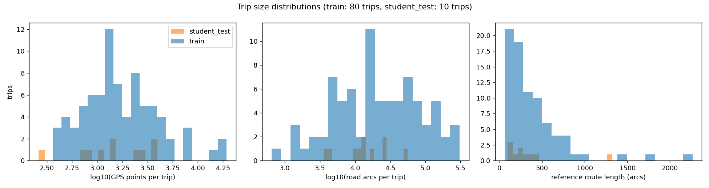

*Figure 2.1: trip size distributions (train and student_test)*


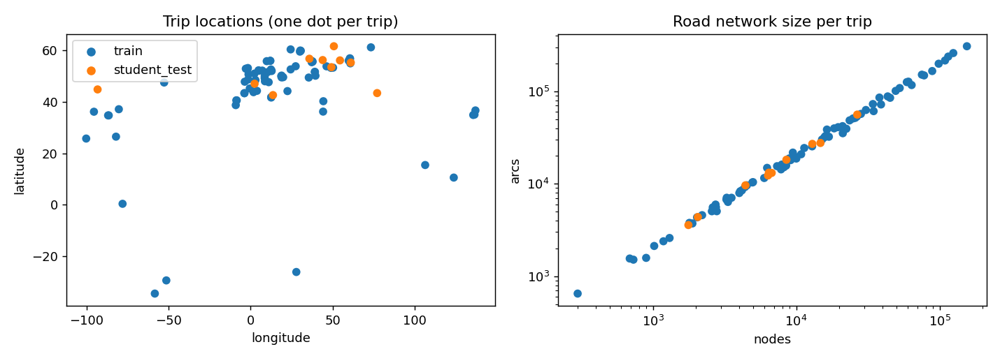

*Figure 2.2: trip locations and road-network size*


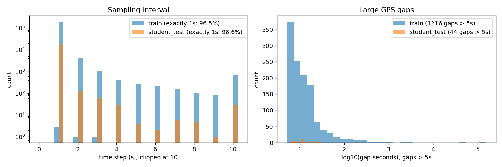

*Figure 2.3: sampling intervals and large GPS gaps*


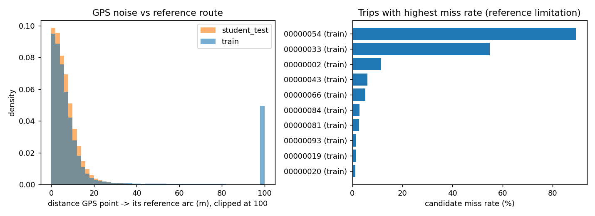

*Figure 2.4: GPS noise relative to the reference route, and candidate miss rate per trip*


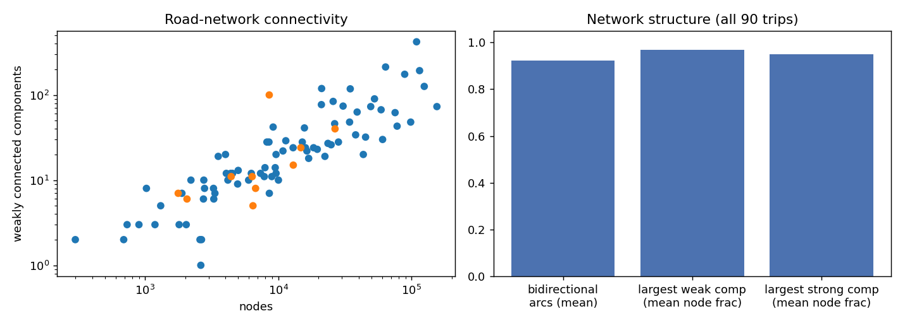

*Figure 2.5: road-network connectivity*


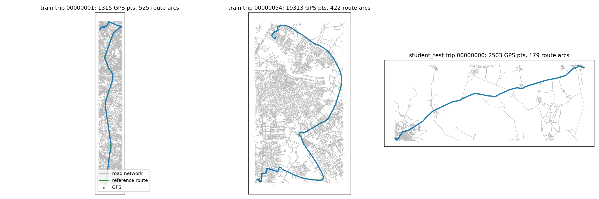

*Figure 2.6: GPS tracks, road network and reference route for three trips*


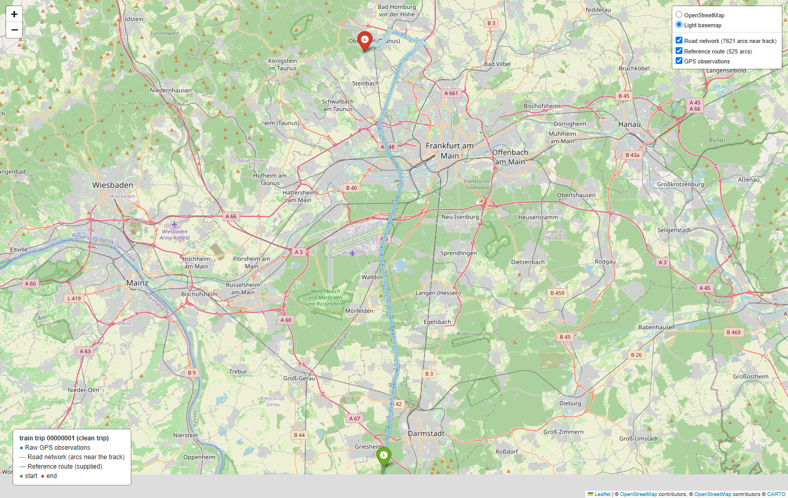

*Figure 2.7: Folium map of train trip 00000001 (GPS, road network, reference route)*


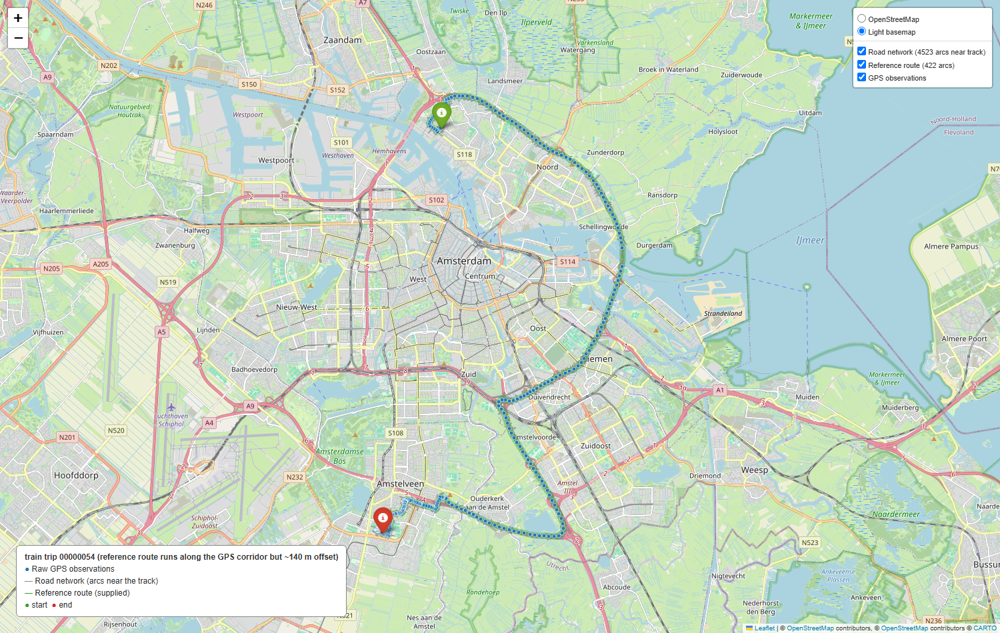

*Figure 2.8: Folium map of train trip 00000054, whose reference route runs about 140 m from the GPS corridor*


# 3. Model experimentation and comparison


### 3.1 Overall model comparison

Cross-validation: 3-fold GroupKFold by trip on 40 whole training trips (seed 42). Student-test: the 10 student_test trips, all 244,176 candidate rows. Top-1 is per-point (highest-probability candidate vs the derived reference arc). Macro-F1 and log loss are binary candidate metrics at threshold 0.5. Route continuity is the classifier alone (no HMM) on student_test, using the shared metric in `src/evaluate.py`; it is not an HMM result. Source: `results/models/model_comparison/comparison.csv` and `results/models/route_continuity_by_model.csv`.

| Model | Algorithm family | Key configuration | CV macro-F1 | Top-1 (CV / student-test) | Route continuity (student-test, classifier only) | Student-test macro-F1 | Log loss (CV / student-test) | Inference time, student-test (s) |
|---|---|---|---:|---:|---:|---:|---:|---:|
| Logistic Regression | Linear / probabilistic | StandardScaler, max_iter=200, binary log-loss | 0.8784 | 0.8269 / 0.8506 | 0.7383 | 0.8995 | 0.1202 / 0.0780 | 0.15 |
| LightGBM | Boosting | 300 trees, learning_rate=0.1, num_leaves=63, binary log-loss | 0.9067 | 0.8327 / 0.8488 | 0.6821 | 0.9163 | 0.1447 / 0.0999 | 1.38 |
| Random Forest | Bagged trees (ensemble) | 100 trees, max_depth=18, min_samples_leaf=20, Gini; capped at 300k fitting rows | 0.9066 | 0.8377 / 0.8535 | 0.7449 | 0.9178 | 0.0977 / 0.0575 | 2.22 |
| MLP | Neural network | hidden (64,32), batch 2048, up to 30 epochs, Adam; capped at 300k fitting rows | 0.9012 | 0.8301 / 0.8561 | 0.7757 | 0.9159 | 0.0871 / 0.0594 | 0.33 |
| KNN | Instance-based | k=25, distance-weighted, ball-tree, StandardScaler; capped at 150k fitting rows | 0.8847 | 0.8088 / 0.8274 | 0.7624 | 0.9004 | 0.2261 / 0.1088 | 448.41 |

Nearest-arc baseline Top-1: 0.5123 (CV mean), 0.5081 (student-test). Per-fold Top-1 standard deviation is 0.012 to 0.019, larger than the gaps between the top three models, so the ranking is narrow. Inference time covers candidate scoring only (not feature generation or HMM decoding); KNN's cheap fit hides its slow prediction.


# Track B: model comparison and Bayesian optimisation

Owner: Aarya, PES1UG24CS496. All values below come from
`results/models/model_comparison/` and `results/models/rf_tuning/`.

## Experimental protocol

The deadline experiment used seed 42 to select 40 complete training trips.
After retaining pt_has_pos=1, 1,103,014 candidate rows were available. The 18
features describe candidate distance, heading, speed, neighbouring GPS evidence,
geometry and endpoint degree. IDs, labels and the filter were excluded.
Three-fold GroupKFold held out entire trips. Preprocessing was fitted inside
each fitting partition. RF/MLP used up to 300,000 fitting rows and KNN up to
150,000; samples retained full candidate groups for each selected observation.
LogReg and LightGBM used all eligible fitting rows. This is a time-budgeted
comparison with differing per-model caps, not an equal-compute benchmark.

Student-test evaluation used all 244,176 candidate rows over 19,160 points in
10 trips, including points without a positive candidate. Reference labels are
derived by route alignment and are not independently verified physical truth.
The rebuilt training table's 210-point coverage discrepancy is documented in
the training provenance file. This run does not use all 80 available training
trips; that limitation should remain explicit in the final report.

## Comparison

The predefined rule selected highest mean fold-level point Top-1, with lower
mean candidate log loss breaking exact ties. Student-test did not choose the
winner. Macro-F1/precision/recall are binary candidate metrics at threshold 0.5,
not multiclass road-ID metrics. Point Top-1 takes the maximum positive-class
probability within each observation's candidate set.

| Model | CV Top-1 | Student Top-1 | CV macro-F1 | Student macro-F1 | CV log loss | Student log loss |
|---|---:|---:|---:|---:|---:|---:|
| Logistic Regression | 0.82690 | 0.85057 | 0.87841 | 0.89946 | 0.12020 | 0.07803 |
| LightGBM | 0.83265 | 0.84880 | 0.90670 | 0.91633 | 0.14471 | 0.09993 |
| Random Forest | **0.83765** | 0.85350 | 0.90664 | **0.91783** | 0.09774 | **0.05753** |
| MLP | 0.83006 | **0.85611** | 0.90122 | 0.91594 | **0.08710** | 0.05937 |
| KNN | 0.80877 | 0.82740 | 0.88474 | 0.90038 | 0.22608 | 0.10875 |

Nearest-arc Top-1 was 0.51233 in mean CV and 0.50809 on student-test. All five
models exceeded these matching baselines. RF's lead over LightGBM was only
0.00500 (0.50 percentage points); no statistical significance is claimed.
MLP achieved the best student-test Top-1, but RF won under the declared CV rule.
Candidate F1 and Top-1 rank models differently because they measure different
decisions. Actual confusion matrices, precision and recall are in metrics.csv.

| Model | Mean CV fit seconds | Mean CV inference seconds | Student inference seconds |
|---|---:|---:|---:|
| Logistic Regression | 4.39 | 0.22 | 0.15 |
| LightGBM | 11.94 | 2.23 | 1.38 |
| Random Forest | 37.71 | 3.35 | 2.22 |
| MLP | 25.14 | 0.51 | 0.33 |
| KNN | 0.47 | 778.20 | 448.41 |

These times cover fitting or candidate scoring, not feature generation or HMM
decoding. KNN's cheap fit hides its expensive neighbour search during prediction.

## Model configurations and interpretation

- Logistic Regression: scaled inputs, max_iter=200, binary log-loss objective.
  It gives a fast linear baseline, but cannot directly represent complex
  nonlinear interactions. Its CV Top-1 was below RF's.
- LightGBM: 300 boosted trees, learning_rate=0.1, num_leaves=63, binary log-loss
  objective. It captures nonlinear interactions efficiently. Its point-ranking
  score was competitive, but its probability log loss was worse than RF's in
  this run; ranking quality and probability quality should not be conflated.
- Random Forest: 100 trees, max_depth=18, min_samples_leaf=20, Gini split
  criterion. Bagged trees capture nonlinear feature combinations; depth/leaf
  limits constrain complexity. It won CV point selection and offered practical
  inference speed. Probability calibration is not assumed from predict_proba.
- MLP: scaled inputs, hidden layers (64,32), batch_size=2048, at most 30 epochs,
  Adam optimisation of binary log loss with regularisation. A whole-trip inner
  holdout chose the epoch count, followed by refitting on capped fitting data.
  It achieved the best student Top-1. Actual monitored and final training
  losses are saved; no curves are invented for tree or neighbour models.
- KNN: scaled inputs, k=25, distance weighting, exact ball-tree search, 150k-row
  cap and 4096-row prediction chunks. It has no iterative optimisation loss;
  neighbour labels determine probabilities. It had the weakest CV Top-1,
  highest CV log loss and largest prediction cost in this comparison.

All models used random seed 42 where applicable. Model-specific parameter JSONs
record remaining defaults. Student-test scores exceed mean CV scores here;
this alone establishes neither absence of overfitting nor proof of underfitting.
The report should not invent training-validation gaps absent logged evidence.
Route continuity and HMM sequence results belong to the decoder experiments.

## Bayesian hyperparameter optimisation

The selected RF was tuned with Optuna TPE, minimising mean three-fold training
CV log loss. The search covered max_depth in [10,22] and min_samples_leaf in
[10,50], retaining 100 trees and the same fit caps. Of 25 requested trials,
six completed before the timeout stopped further trials. The first five are
startup trials; only the sixth uses the subsequent TPE proposal mechanism.
Search time was 676.67 seconds because timeout checks occur between trials.
An earlier interrupted study is preserved separately and is not counted as a
completed 25-trial search. No evaluator data entered optimisation.

Best trial: max_depth=12, min_samples_leaf=16, CV log loss=0.0807695.

| Metric | Untuned RF | Tuned RF |
|---|---:|---:|
| Mean CV Top-1 | **0.83765** | 0.83640 |
| Mean CV log loss | 0.09774 | **0.08077** |
| Student Top-1 | 0.85350 | **0.85402** |
| Student macro-F1 | 0.91783 | **0.91802** |
| Student log loss | **0.05753** | 0.05779 |

Tuning improved its CV objective but produced mixed generalisation results.
Student point selection improved by 10 points out of 19,160, only 0.052
percentage points; student log loss slightly worsened. The tuned artifact was
selected on CV log loss, not by choosing whichever version looked better on
student-test. No broad superiority or guaranteed calibration is claimed.


### 3.3 Model visualisations (student-test and cross-validation results)


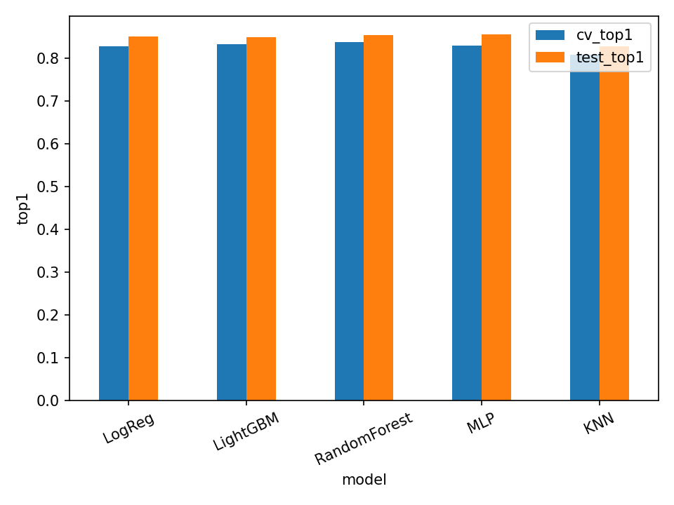

*Figure 3.1: per-point Top-1 accuracy by model*


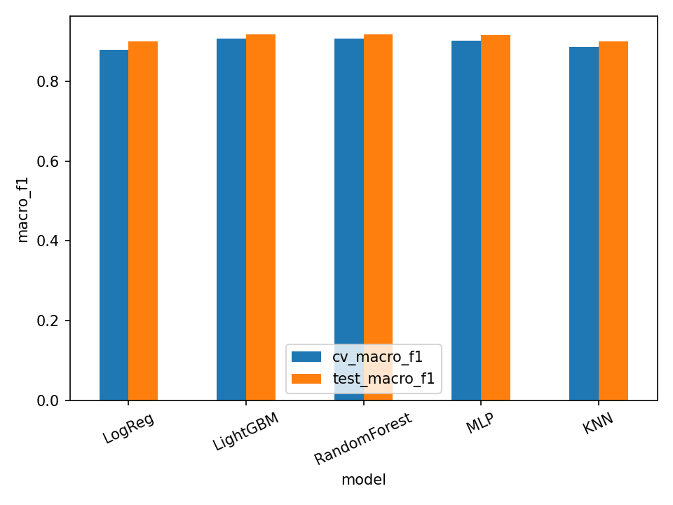

*Figure 3.2: macro-F1 by model*


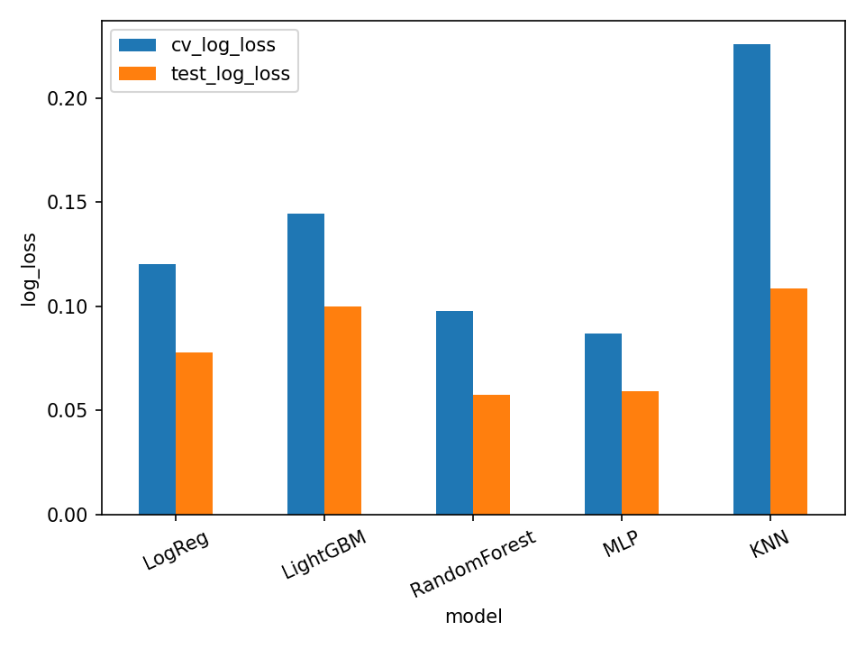

*Figure 3.3: log loss by model*


Only the MLP produces an epoch-wise training history (`results/models/model_comparison/MLP_loss_curve.csv`); no curves are drawn for the other models. **[NEEDED: per-model answers to the compulsory questions A, B and C of section 3.2 (suitability, hyperparameters and loss, results, over- or under-fitting evidence), written by the model owner.]**


# 5. HMM and Viterbi Route Reconstruction

> Draft built from the committed results in `results/`. The team must review it, rewrite it in its own words and be able to
> explain every statement. All numbers below come from `results/hmm/final/hmm_decoder_comparison_model.csv` and its per-trip file unless noted.

## 5.1 States and emission scores

A GPS point can be close to several roads, so choosing a road independently for each point can make the route jump between them.
We tested whether using the neighbouring points' choices resolves this.

At each GPS point the hidden states are its candidate directed road arcs. We keep `point_idx` and `arc_id` with every candidate, so
the decoder returns one arc id per GPS point (or -1 when a point has no candidate). Each trip uses its own road graph. The reference
route is used only for scoring after prediction and never as decoder input.

The emission score of a candidate is the log of the classifier's probability that it is the correct arc. The classifier is the tuned
Random Forest (`artifacts/model.joblib`, trained on 40 training trips; see section 4). Before the trained model was available we
used a heuristic stand-in, softmax(-dist_m/10 + 3*cos_head) per GPS point. Those earlier results are kept in
`results/hmm/stand_in/hmm_decoder_comparison_mock.csv` as a baseline and are not the final results.

## 5.2 Two transition designs

Both decoders are compared on the same trips, with the same probabilities.

**Fixed-transition decoder** (`src/hmm_fixed.py`, config `artifacts/hmm_fixed_config.json`). A log score of 0 for staying on the same
arc, -1.0 for moving to a directly adjacent arc (the previous arc ends where the next starts), and -8.0 for any other movement. It is cheap,
but moving across several short road segments between two samples is scored like an unrelated jump. The sequence restarts after a time
gap above 30 s, a missing-candidate point, or a nonpositive or non-finite time difference.

**Multi-hop decoder** (`src/hmm.py`, config `artifacts/hmm_config.json`, used by the API). It allows travel through intermediate arcs. A
memoised, depth-limited breadth-first search on directed arc connections finds how many arcs apart two candidates are:

```
depth = max_hops + floor(min(dt, gap_s) / gap_hop_s)
```

Staying on an arc costs 0; reaching another arc in h hops costs `hop_penalty * h`; an immediate move to the reverse arc costs
`uturn_penalty`; if the arc is not found within the search depth the decoder applies `jump_penalty`. The tuned values are hop_penalty=2,
jump_penalty=20, uturn_penalty=16, max_hops=5, gap_s=120 s, gap_hop_s=5 s. After a gap above 120 s, transition costs are set to zero so the new
point is independent of the previous choice. Points with no candidate stay -1 and decoding continues across them using the elapsed time.
For nonpositive time differences it substitutes 1 s; it has no explicit check for non-finite timestamps.

These costs are dimensionless scores. A hop is an arc transition, not a distance in metres, and neither active decoder computes metric
shortest paths. Both use finite penalties, so decoding can recover from poor candidate sets, but a disconnected result is still possible.
Neither decoder inserts connector arcs between predictions.

## 5.3 Viterbi recurrence

```
V_t(j) = emission_t(j) + max_i [ V_(t-1)(i) + transition_t(i, j) ]
```

For each candidate j we keep the best score of a sequence ending there and the previous candidate that gave it. After the forward pass we
backtrack from the best final candidate. This differs from picking the largest emission at every point: a slightly weaker local choice can
belong to a better complete sequence. Working with log scores avoids multiplying many small probabilities.

## 5.4 Experiment and metrics

**Trips and tuning.** 54 whole trips: 22 training trips labelled TUNE, 22 labelled VAL and the 10 student_test trips (seed 0).
Training trips with a candidate miss rate above 5%, or with more than 8,000 points, are excluded, so the comparison does not cover every
training trip or the longest trips. **Both decoders were tuned with the same coordinate search on the TUNE trips only, using the
trained model's probabilities.** The search logs are `results/hmm/final/hmm_tuning_multihop_model.csv` and `results/hmm/final/hmm_tuning_fixed_model.csv`.
VAL and student_test were not used to choose any setting. Evaluator trips were never used. (An earlier comparison on stand-in probabilities tuned the two
decoders on different trips; that limitation no longer applies.)

**Metrics.** Point accuracy counts correct arc ids on points whose derived reference arc is within 60 m of the GPS point. Reference
labels come from aligning points to the route and are not independently verified physical truth. Direct continuity (from `src/evaluate.py`)
is the fraction of changes in the predicted arc where the first arc ends at the next arc's start node; it does not credit a connection through
intermediate arcs, so a valid multi-hop movement lowers it. The sequence metric is the fraction of non-overlapping 50-point windows in which
every prediction matches the reference label; it uses all points, without the 60 m mask. Averages give each trip equal weight.

### TUNE (22 training trips)

| Pipeline | Point accuracy | Exact 50-point windows | Direct continuity | Trips better / worse than classifier-only |
|---|---:|---:|---:|---:|
| Classifier only (tuned Random Forest) | 85.67% | 22.40% | 72.57% | n/a |
| Fixed-transition HMM | 88.92% | 28.16% | 97.85% | 19 / 2 |
| Multi-hop HMM | 91.99% | 42.66% | 88.89% | 22 / 0 |

### VAL (22 training trips not used for tuning)

| Pipeline | Point accuracy | Exact 50-point windows | Direct continuity | Trips better / worse than classifier-only |
|---|---:|---:|---:|---:|
| Classifier only | 87.80% | 24.82% | 75.56% | n/a |
| Fixed-transition HMM | 91.42% | 31.42% | 98.66% | 20 / 0 |
| Multi-hop HMM | 94.10% | 44.20% | 92.18% | 22 / 0 |

### STUDENT_TEST (10 trips)

| Pipeline | Point accuracy | Exact 50-point windows | Direct continuity | Trips better / worse than classifier-only |
|---|---:|---:|---:|---:|
| Classifier only | 86.52% | 26.91% | 74.61% | n/a |
| Fixed-transition HMM | 88.79% | 30.75% | 98.53% | 8 / 1 |
| Multi-hop HMM | 91.78% | 39.53% | 90.62% | 9 / 1 |

"Worse" means more than 0.5 percentage points below classifier-only.

**Live API check** (`results/hmm/final/api_hmm_check_model.csv`): the API in `hmm` mode on all 10 student_test trips gives mean point accuracy 0.865 for the
classifier alone and 0.917 after the multi-hop HMM, with mean continuity 0.906.

**Timing.** Decoding all 22 VAL trips took 16.8 s with the multi-hop decoder and 4.7 s with the fixed decoder in the committed run, excluding feature
preparation and API overhead. Times depend on the machine and on what else is running (an earlier run of the same code was faster), so we
report them only as a rough comparison: multi-hop was about 2 to 4 times slower than fixed transitions, and both are fast enough for the live demo.

## 5.5 What helped and what did not

- **The HMM helps consistently.** The multi-hop decoder improved accuracy on all 22 TUNE and all 22 VAL trips, and on 9 of 10 student_test trips.
  The gain over classifier-only is about 6 points on TUNE and VAL and about 5 points on student_test. It also raises the exact 50-point windows
  from about 22 to 27% to about 40 to 44%.
- **Multi-hop is more accurate; fixed transitions are more continuous.** Multi-hop is higher on accuracy and sequence score in every split, while the fixed
  decoder is higher on direct continuity (about 98% vs 89 to 92%). The continuity metric penalises skipping over a road segment even when the graph
  has a valid connecting path, so continuity alone is not enough to choose a decoder. We use the multi-hop variant in the API because of its measured
  accuracy advantage.
- **Largest improvement, train trip 00000004 (VAL):** accuracy 65.13% (classifier) to 85.62% (fixed) to 91.07% (multi-hop). The fixed decoder
  corrected 239 classifier errors and introduced 21. See section 6 for the maps.
- **Where fixed transitions did not help, train trip 00000078 (TUNE):** classifier 92.16%, fixed 90.75% (it corrected 123 errors but introduced
  164, a net loss of 41 correct points) although continuity rose from 76.7% to 95.3%. The longest time gap in this trip is 52,810 s. The multi-hop decoder
  reached 96.80% on the same trip. This trip is in the tuning set, so it illustrates a failure mode and is not held-out evidence. We have not established
  the physical cause of each error.
- **Where the multi-hop HMM did not help, student_test trip 00000007:** accuracy fell from 86.7% to 85.4%. Higher smoothing can keep a plausible but wrong road
  when the classifier was already right.

## 5.6 Limitations

- Only 54 trips are compared, and the evaluator trips (hidden) may behave differently.
- The reference labels are derived and imperfect, and 10 training trips have route breaks, so point accuracy has a ceiling below 100%.
- Both decoders use the classifier's probabilities as they are. We did not calibrate them, and a different classifier could change which decoder settings are best.
- Direct continuity is a strict metric; it undervalues multi-hop movements.
- AI assistance was used for implementation, verification and drafting of this section. The team must review it before submission.

Reproduce: `python src/compare_decoders.py --prob model` (decoder comparison) and `python src/eval_hmm.py --mode tune --prob model [--decoder fixed] --save-config` (tuning).


# 6. Geographical visualisation: HMM map figures

These are report-only illustrations made with the trained model's probabilities (`artifacts/model.joblib`) and the tuned
decoder settings. They include the reference route, so they must not be used as API or UI artifacts. Both examples are training
trips, and their split is stated below. They illustrate behaviour and are not held-out evidence. No evaluator trips were read.

Each comparison has three panels: classifier only, fixed-transition HMM and multi-hop HMM (the one the API uses). Every panel shows
the GPS points (blue), nearby road arcs (grey), the supplied reference route (green halo), the predicted arcs (red), start and end markers, a legend and
a layer control. Orange rings mark points whose chosen arc differs from the derived reference label, using the same 60 m mask as section 5.
Reverse-direction arcs can have identical geometry, so the rings show errors that route lines alone hide. The accuracy and continuity in each
panel heading are whole-trip values, not values for the zoomed window. The maps use the repository's local Leaflet files and no external
basemap (the grey background is intentional; the roads drawn are the supplied trip network).

## Improvement example: train trip 00000004 (VAL split)

| Pipeline | Whole-trip accuracy | Direct continuity |
|---|---:|---:|
| Classifier only | 65.13% | 51.05% |
| Fixed HMM | 85.62% | 91.35% |
| Multi-hop HMM | 91.07% | 77.17% |

The fixed decoder corrects 239 classifier errors and introduces 21 others. The detail window (points 291 to 331) is the 41-point stretch with
the most points corrected by fixed decoding. It is an illustrative selected region, not a random sample.

[Interactive comparison](../results/maps/hmm_compare_00000004_comparison.html)

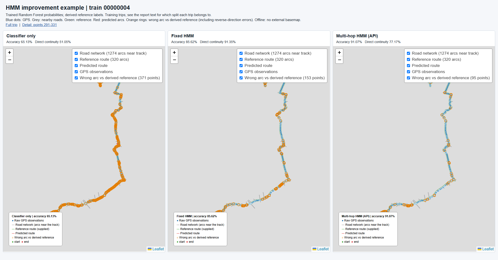

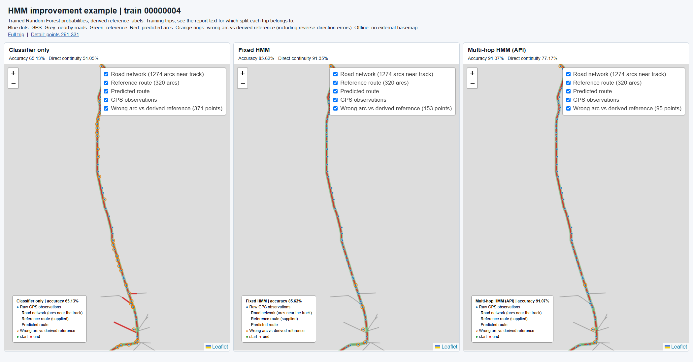

## Fixed-transition regression: train trip 00000078 (TUNE split)

| Pipeline | Whole-trip accuracy | Direct continuity |
|---|---:|---:|
| Classifier only | 92.16% | 76.71% |
| Fixed HMM | 90.75% | 95.34% |
| Multi-hop HMM | 96.80% | 82.88% |

The fixed decoder corrects 123 classifier errors but introduces 164, a net loss of 41 correct point assignments, even though direct continuity rises.
The detail window (points 2532 to 2572) is the stretch with the most points where the classifier is right and fixed decoding is wrong. Some errors are
direction errors on the same geometry, so use the orange rings as well as the route overlays. These are observed label changes; the figures do not
establish the physical cause of each error.

[Interactive comparison](../results/maps/hmm_compare_00000078_comparison.html)

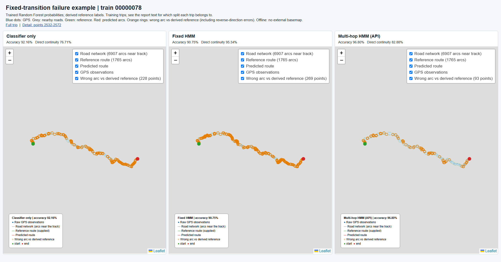

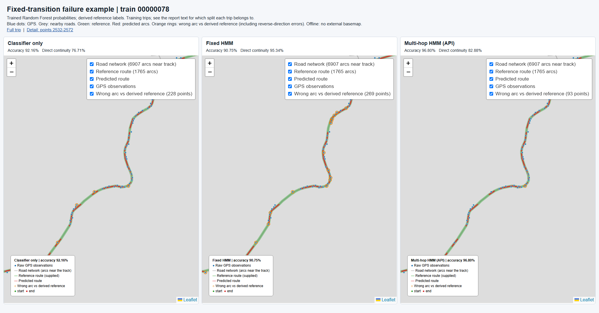

## Other maps
- `results/figures/folium_map_*.png`: EDA maps of three trips (GPS, road network, reference route) with an online basemap.
- `results/maps/map_*.html`: the interactive versions of those maps.

## Reproduce

```
python src/make_hmm_figures.py --data-root data --tag NEW_UNIQUE_TAG --prob model --improve-trip 00000004 --regress-trip 00000078
```

The tag must be new (the script refuses to overwrite existing output). It writes HTML, predictions and a manifest with metrics, configs and file hashes
under `results/maps/`. Screenshots can be added with `--screenshots` (needs Playwright) or by opening the comparison page with `?view=overview` or `?view=detail`
in a browser. The script now also runs on Python 3.10. AI assistance was used for the generator and these notes.


## 7. API, UI and Deployment

Implemented in `api/` (FastAPI) and `ui/` (browser workspace served by the API at `/ui/`). `GET /trips` lists the configured trips; `POST /predict {trip_id}`
builds features with `prepare_trip` (which never opens the `.route` file), runs the classifier and the HMM, and only then computes aggregate scoring against the
reference on laptop 1. The response carries GPS points, the predicted route and aggregate metrics, never the reference route or labels. Every request is logged on the API
terminal with a request id, trip id, number of points, elapsed time and accuracy. `tests/test_no_leakage.py` shows that the features are identical with and without the
route file, and a fresh clone of the public repository ran all 10 student_test trips in `hmm` mode (pipeline `classifier + HMM/Viterbi`).

| Deployment evidence | Value / source |
|---|---|
| Final commit | see `git log` of the submitted repository |
| Prediction modes | `nearest` (development baseline), `classifier`, `hmm` (final); `hmm` refuses to start without `artifacts/model.joblib` |
| All 10 student_test trips in `hmm` mode | `results/hmm/final/api_hmm_check_model.csv`: mean accuracy 0.865 (classifier alone) to 0.917 (with HMM), mean continuity 0.906 |
| Laptop-to-laptop connection (development mode) | A second laptop on the same Wi-Fi called the API on laptop 1 (port 8000); the requests appear in laptop 1's API log with the second laptop's client IP and matching request ids |
| Final-mode demonstration on laptop 2 | **[NEEDED: repeat with `PATHSNAP_MODE=hmm` and capture the screenshots below]** |

**[NEEDED: Figure 7-A]** Laptop 2 UI showing a completed trip (GPS, predicted route, metrics) with the pipeline shown as `classifier + HMM/Viterbi`.

**[NEEDED: Figure 7-B]** Laptop 1 API terminal showing the matching request id, the second laptop's client IP, trip, number of points, time and accuracy.

Reproduce: `python -m uvicorn api.main:app --host 0.0.0.0 --port 8000` with `PATHSNAP_MODE=hmm`; set `PATHSNAP_TRIPS_DIR` to the folder with the evaluation trips.
A Windows firewall rule for TCP port 8000 and a shared network are required; `scripts/check_all_trips.py --api http://<laptop-1-ip>:8000` checks all trips from the second laptop.


## 8. Academic integrity and AI assistance

All reported numbers come from committed result files and can be regenerated with the scripts listed in the repository README. Learned preprocessing was
fitted on training data only, cross-validation folds are grouped by trip, the evaluator trips were never opened during development, and the reference route is
never used by the prediction path.

**[NEEDED: AI-use disclosure.]** The event policy requires each member to state which AI tools helped with which parts of the work (for example code, tests,
report drafting) and what they checked themselves. Each member should write their own entry here and be able to explain their code, experiments and results.
