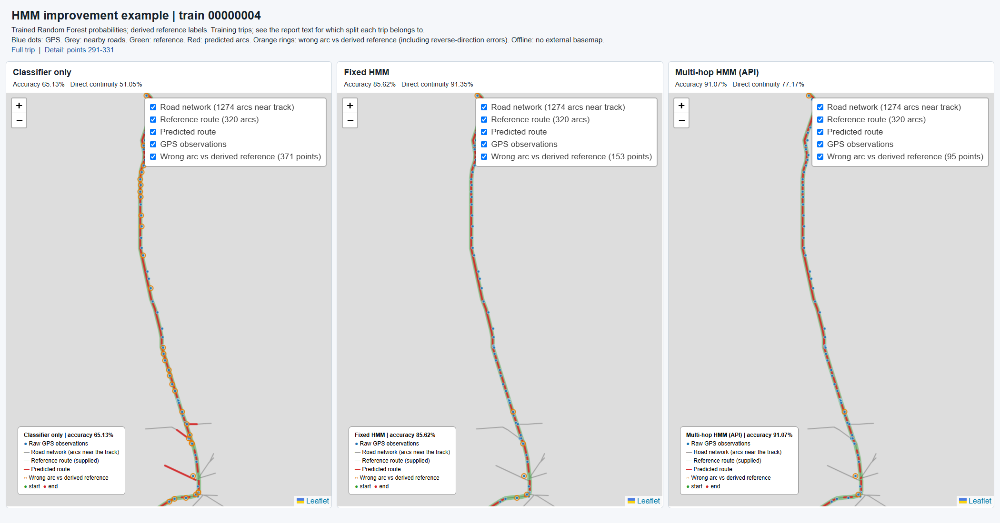

# 6. Geographical visualisation: HMM map figures

These are report-only illustrations made with the trained model's probabilities (`artifacts/model.joblib`) and the tuned
decoder settings. They include the reference route, so they must not be used as API or UI artifacts. Both examples are training
trips, and their split is stated below. They illustrate behaviour and are not held-out evidence. No evaluator trips were read.

Each comparison has three panels: classifier only, fixed-transition HMM and multi-hop HMM (the one the API uses). Every panel shows
the GPS points (blue), nearby road arcs (grey), the supplied reference route (green halo), the predicted arcs (red), start and end markers, a legend and
a layer control. Orange rings mark points whose chosen arc differs from the derived reference label, using the same 60 m mask as section 5.
Reverse-direction arcs can have identical geometry, so the rings show errors that route lines alone hide. The accuracy and continuity in each
panel heading are whole-trip values, not values for the zoomed window. The maps use the repository's local Leaflet files and no external
basemap (the grey background is intentional; the roads drawn are the supplied trip network).

## Improvement example: train trip 00000004 (VAL split)

| Pipeline | Whole-trip accuracy | Direct continuity |
|---|---:|---:|
| Classifier only | 65.13% | 51.05% |
| Fixed HMM | 85.62% | 91.35% |
| Multi-hop HMM | 91.07% | 77.17% |

The fixed decoder corrects 239 classifier errors and introduces 21 others. The detail window (points 291 to 331) is the 41-point stretch with
the most points corrected by fixed decoding. It is an illustrative selected region, not a random sample.

[Interactive comparison](../results/maps/hmm_compare_00000004_comparison.html)




## Fixed-transition regression: train trip 00000078 (TUNE split)

| Pipeline | Whole-trip accuracy | Direct continuity |
|---|---:|---:|
| Classifier only | 92.16% | 76.71% |
| Fixed HMM | 90.75% | 95.34% |
| Multi-hop HMM | 96.80% | 82.88% |

The fixed decoder corrects 123 classifier errors but introduces 164, a net loss of 41 correct point assignments, even though direct continuity rises.
The detail window (points 2532 to 2572) is the stretch with the most points where the classifier is right and fixed decoding is wrong. Some errors are
direction errors on the same geometry, so use the orange rings as well as the route overlays. These are observed label changes; the figures do not
establish the physical cause of each error.

[Interactive comparison](../results/maps/hmm_compare_00000078_comparison.html)


## Other maps
- `results/figures/folium_map_*.png`: EDA maps of three trips (GPS, road network, reference route) with an online basemap.
- `results/maps/map_*.html`: the interactive versions of those maps.

## Reproduce

```
python src/make_hmm_figures.py --data-root data --tag NEW_UNIQUE_TAG --prob model --improve-trip 00000004 --regress-trip 00000078
```

The tag must be new (the script refuses to overwrite existing output). It writes HTML, predictions and a manifest with metrics, configs and file hashes
under `results/maps/`. Screenshots can be added with `--screenshots` (needs Playwright) or by opening the comparison page with `?view=overview` or `?view=detail`
in a browser. The script now also runs on Python 3.10. AI assistance was used for the generator and these notes.
