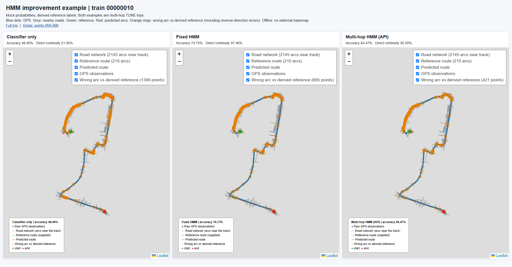
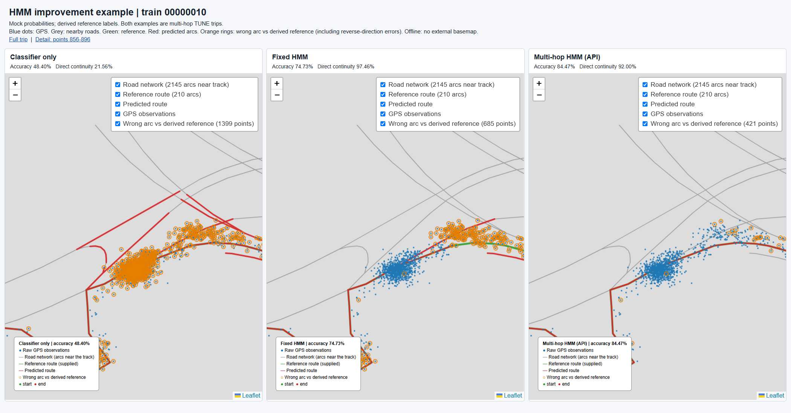
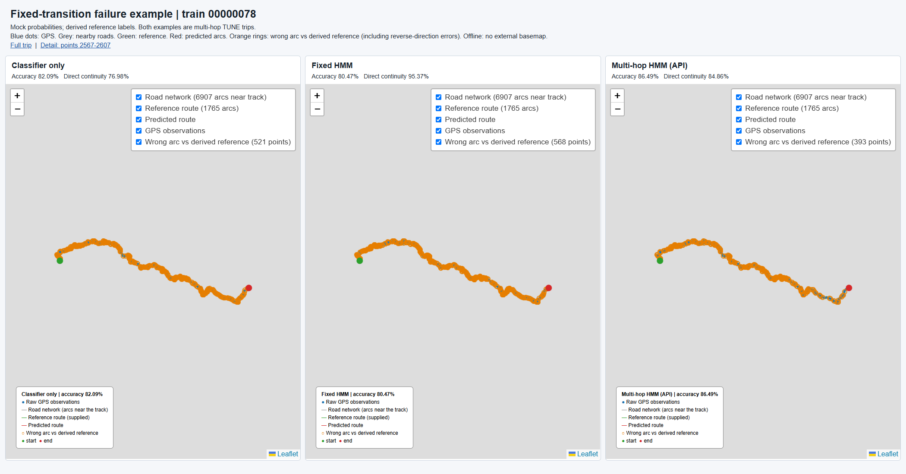
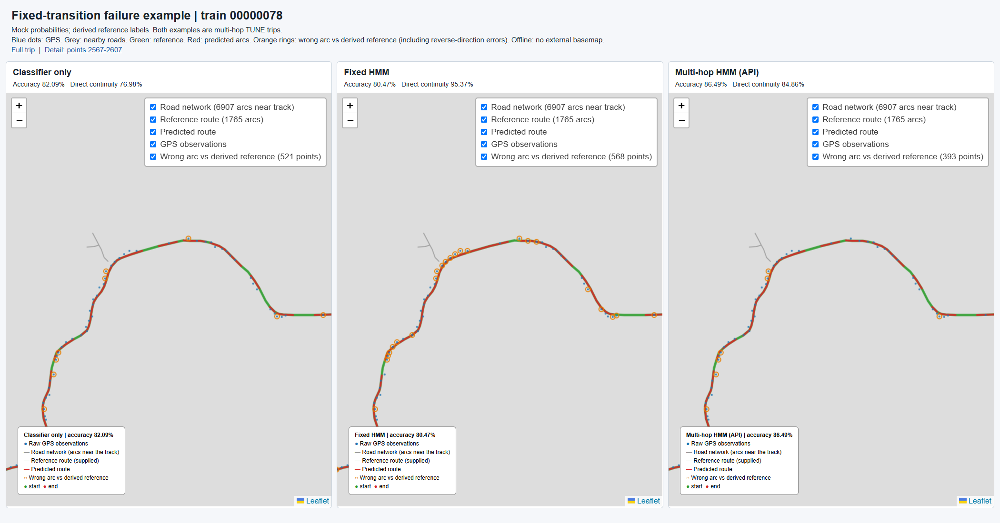

# HMM map figures for sections 5 and 6

These are report-only training-trip illustrations with mock probabilities. They
include reference routes and must not be used as API/UI response artifacts.
Both examples are in the multi-hop TUNE set; they do not demonstrate held-out
performance. No evaluator trips were read.

Each comparison has classifier-only, fixed-HMM and API multi-hop-HMM panels.
Every panel includes GPS points, nearby road arcs, supplied reference route,
predicted arcs, start/end markers, a legend and layer control. Orange rings mark
points whose selected arc differs from the derived reference label, using the
same <=60 m reference-distance mask as the report comparison. Reverse arcs can
have identical geometry; the rings reveal errors that route lines alone hide.
Map accuracy labels describe the whole trip, including when the view is zoomed.

## Improvement: train 00000010

Accuracy: classifier 48.40%, fixed HMM 74.73%, multi-hop HMM 84.47%.
The fixed decoder corrects 831 classifier errors but introduces 117 others.
This illustrates the net improvement without implying every change helped.

[Interactive comparison](../results/maps/hmm_mock_20261118_v3_00000010_comparison.html)





Detail caption: this 41-observation window was selected because it has the most
points corrected by fixed decoding. It is an illustrative selected region, not
a randomly sampled evaluation. Compare the orange error rings across panels.

## Regression: train 00000078

Accuracy: classifier 82.09%, fixed HMM 80.47%, multi-hop HMM 86.49%.
Fixed transitions correct 144 classifier errors but introduce 191 others, a net
loss of 47 correct point assignments. Higher direct continuity (76.98% to 95.37%)
does not imply higher accuracy. These are observed label changes; the figures do
not establish the physical cause of each error.

[Interactive comparison](../results/maps/hmm_mock_20261118_v3_00000078_comparison.html)





Detail caption: this window maximises points where the classifier is correct and
fixed decoding is wrong. Some mistakes concern direction on the same geometry,
so use the orange rings as well as the route overlays. The metrics in the panel
headings are whole-trip values, not values for this selected window.

## Reproduce and update

From the repository root:

```powershell
python -m pip install -r requirements-figures.txt
python src/make_hmm_figures.py --data-root "../Student folder" --tag NEW_UNIQUE_TAG --screenshots --browser "C:\Program Files (x86)\Microsoft\Edge\Application\msedge.exe"
```

The tag must be new: the script refuses any existing matching output. HTML,
predictions, screenshots and a metric/config/hash manifest are written under
`results/maps/`. HTML uses the repo's local Leaflet assets and no external tiles,
CDNs or geocoding. Keep the repo-relative folder structure when opening it.
Screenshots run in a headless offline browser with HTTP and HTTPS blocked.
The grey background is intentional; the displayed roads come from the supplied
trip network. Browser rendering checks layer controls and raises on JS errors.

`src/viz.py::make_trip_map` retains its original online default for existing callers;
this report generator explicitly selects offline mode. The new `point_errors`
argument is optional and is for reference-backed report visualization only.

When the model arrives, the data-pipeline owner retunes both decoders. Then adapt
this generator to load the model's positive-class probabilities with exactly the
training feature order and any scaler. Use both new configs, a fresh output tag,
and update the captions and section 5 from that run. Do not relabel these mock
maps as trained-model results. AI assistance was used for the generator and notes.

